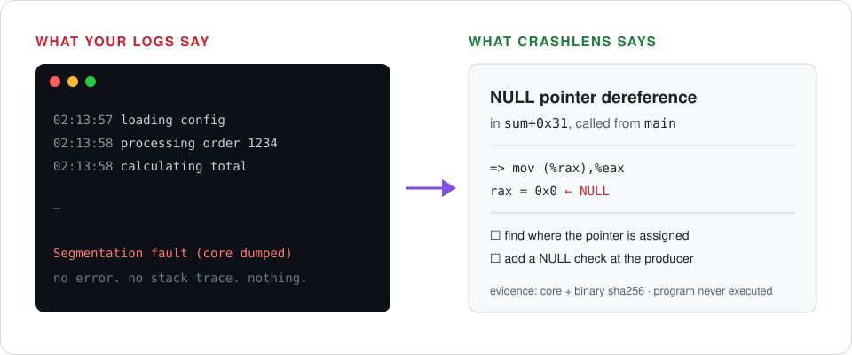
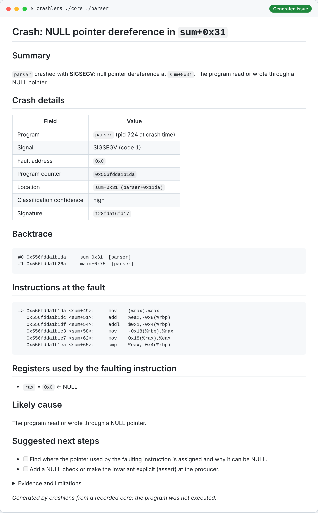
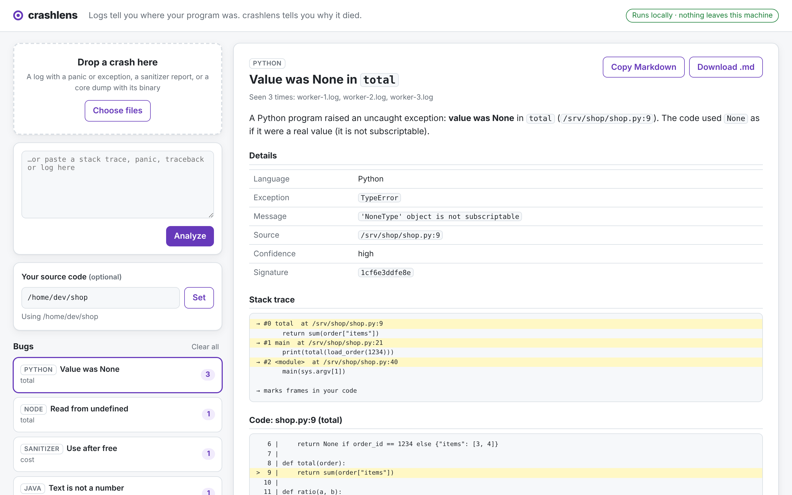
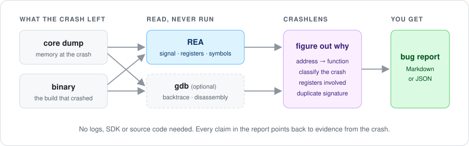

# crashlens

[](https://github.com/mingleiw/crashlens/actions/workflows/ci.yml)
[](LICENSE)

**Logs tell you where your program was. crashlens tells you why it died.**

The line that crashed is where a bad value was *used*. crashlens finds where it
was *made*, so you (or your coding agent) fix the bug instead of hiding it.

**[▶ Try the live demo](https://mingleiw.github.io/crashlens/)**: paste a stack trace and see the report, right in your browser.

Use it [in your browser](#use-it-in-your-browser), [from the command line](#or-from-the-command-line),
or [from your coding agent](#use-it-from-coding-agents) (Claude Code plugin + MCP server):

```text
/plugin install crashlens --marketplace mingleiw/crashlens
```

When a program crashes, the logs usually just stop. crashlens reads what the
crash left behind (a core dump, a panic, an exception, a sanitizer report) and
writes a bug report you can paste into an issue: where it died, why, the log
lines right before it, and, if you point it at your repo, where the bad value
came from (often a different file), what probably went wrong there, and who
last changed it. It never runs your program and needs no SDK.



```bash
crashlens ./core ./parser > crash.md
```

<details open>
<summary><b>A real report</b>, generated from a crashed C program (paste it straight into a GitHub issue)</summary>
<br>

</details>

## Why: the crash line is the smoke alarm, not the fire

An orders service crashes in the email code: `'NoneType' object has no
attribute 'name'`. A comment next to the crash says the customer "can be
missing for guest checkouts". Given only the error, Claude Code fixed it like
this in **10 of 13 runs**:

```diff
  customer = repository.get_customer(order.customer_ref)
+ if customer is None:
+     # Guest checkout or deleted account: there is no address to send a receipt to.
+     log.warning("no customer for order %s; skipping receipt", order.id)
+     return
```

The crash is gone, and no customer ever gets a receipt again. The real bug is
three files away: the API sends `customerId` and `models.py` reads
`customer_id`. With the same error plus a crashlens report, which traces
`customer` back to that lookup and says "the lookup found nothing, check the
key before guarding the crash site", **9 of 13 runs fixed `models.py`**.

| Benchmark ([bench/](#does-it-help-agents-benchmark)) | Without crashlens | With crashlens |
| --- | --- | --- |
| Misleading comment at the crash, bug 3 files away (13 runs) | 3/13 root-cause fixes | **9/13** |
| Case-mismatched id, smaller model (3 runs) | 0/3 (all added `if (!user)`) | **3/3** |
| Stripped binary + core dump: turns to the root cause | 4 | **1** |
| Bug 1 file away (CSV columns shifted): turns | 7 | **3** |

Where it made no difference: on simple bugs a strong model finds the root
cause anyway, and the report mostly saves turns. These are small test repos,
not a study. The harness is in the repo, so rerun it and send results.

> **Status:** early prototype. Reads Linux x86-64 core dumps (including stripped
> binaries with no source), Go/Rust panics, Python tracebacks, Java and Node.js
> stack traces, and ASan/LSan/UBSan reports. Got a crash that stumped you? Open
> an issue. Real crashes are the best test cases.

## Use it in your browser

The [live demo](https://mingleiw.github.io/crashlens/) runs the same interface
with sample bugs, plus a **Try a sample core dump** button that walks through a
real native crash. Pasted text is analyzed in your browser and never uploaded.
To analyze core dumps, read your source code or watch live logs, run it
locally:

```bash
crashlens serve
```

Open the URL it prints, then drag in logs, sanitizer reports, or a core dump
with its binary, or paste a stack trace. Every bug gets a report you can copy
as Markdown, and the same bug from many files is grouped with a count.



The app runs on `127.0.0.1` only, needs the private token in the URL it
prints, loads nothing from the internet, and deletes uploaded files when it
stops.

## Or from the command line

```bash
crashlens ./core ./app                     # a native crash: core dump + the binary
python app.py 2>&1 | crashlens -           # any supported failure, piped in
crashlens error.log --source ~/code/shop   # ...and show the failing code + git blame
crashlens --batch ./crashes ./app          # a folder of crashes, grouped into bugs
```

## Use it from coding agents

crashlens ships as a Claude Code plugin: a skill that teaches the agent when
to use it and how to fix the root cause, plus an MCP server with four
read-only tools (`analyze_failure`, `analyze_core_dump`, `decompile_function`,
`analyze_crash_folder`).

```text
/plugin install crashlens --marketplace mingleiw/crashlens
```

On Claude Code older than 2.1.275, use two steps:
`/plugin marketplace add mingleiw/crashlens`, then `/plugin install crashlens@crashlens`.

Then just work as usual. When a test panics or a service throws, the agent
passes the output to crashlens and gets the failing frame in your code, where
the bad value came from, the likely cause and a stable signature. The skill
has it state that hypothesis and fix the code that produced the value, not
add a guard at the crash site, then rerun to check the signature is gone. The plugin bundles crashlens into one file, so it needs nothing but
Node.js. Core dumps also need REA and `REA_PWNTOOLS_PYTHON` (see
[Install](#install)).

Other MCP clients (Cursor, Codex, Claude Desktop, ...) can run the same server
from a checkout:

```json
{ "mcpServers": { "crashlens": { "command": "node", "args": ["/path/to/crashlens/plugin/crashlens.mjs", "mcp"] } } }
```

No plugin? [docs/prompts/crash-triage.md](docs/prompts/crash-triage.md) is a
copy-paste prompt that walks any agent with REA connected from a core dump to a
root cause, the same way crashlens does.

The skill itself ([plugin/skills/crashlens/SKILL.md](plugin/skills/crashlens/SKILL.md))
uses only portable frontmatter, so it also works as a standalone Agent Skill.

## Does it help agents? (benchmark)

`bench/` is an A/B test. A coding agent (Claude Code, headless) fixes each
small crashing project twice: once with only the error output (A), once with
the error output plus the crashlens report (B). Each diff is scored as a
root-cause fix or a symptom guard.

- **11 cases** in Python and JavaScript: a None from a lookup, a case-mismatched
  id, a renamed field across a queue, an environment string used as a number,
  a missing `await`, a currency code two files away, shifted CSV columns.
- **4 held-out cases** (`"heldout": true` in [bench/cases.json](bench/cases.json))
  were written after the report's checks were frozen, with the bug two or
  three files from the crash and, in three, a misleading comment at the crash.

```bash
npm run build
node bench/run.mjs --cases py-customer --reps 10       # the receipt example above
node bench/run.mjs --model haiku --reps 3              # all cases, smaller model
node bench/run.mjs --rescore /path/to/run              # rescore saved runs
```

It runs the case programs and `claude`, which costs API usage, and writes
every prompt, diff and a summary table to a folder. Scoring is by pattern, so
read the diffs before quoting numbers.

What we have seen so far:

- **Strong model:** it finds the root cause on most cases without help. It
  failed when a plausible comment at the crash said the value could be
  missing (3/13 → 9/13 with the report), and the report cut turns when the
  bug was in another file (7 → 3, 5.7 → 4).
- **Smaller model:** without the report it guarded the crash site on the
  case-mismatch bug every time; with it, 21/21 runs on the first 7 cases fixed
  the root cause.
- **Native crashes:** the decoded core and pseudocode took the agent from 4
  turns to 1 and cut cost by about a third.
- **Where it didn't help:** on single-file bugs the strong model was already
  right; the report only added tokens.

## What it recognizes

**Native crashes (core dumps)**

- NULL and near-NULL pointer dereferences
- stack overflow (runaway recursion, huge stack buffers)
- invalid memory access, writes to read-only memory, jumps to non-executable memory
- general protection faults (garbage pointers)
- failed `assert()`, uncaught C++ exceptions, glibc heap-corruption aborts
- divide by zero, illegal instruction, bus error, trap

**Go panics**: nil pointer dereference, index/slice out of range, write to nil
map, divide by zero, failed type assertion, concurrent map access, deadlock,
closed-channel misuse, stack overflow, explicit `panic(...)`

**Python**: `None` used as a value, missing dict key, index errors, bad JSON,
missing files, network errors, import errors, recursion, and chained exceptions
(reports the root cause of `raise ... from e`)

**Java**: NullPointerException (with the JVM's "because ... is null" detail),
index out of bounds, bad casts, NumberFormatException,
ConcurrentModificationException, stack overflow, out of memory, and the
deepest `Caused by:` in a chain

**Node.js**: `Cannot read properties of undefined`, "is not a function",
undefined variables, bad JSON, `ENOENT`/`ECONNREFUSED`, stack overflow

**Sanitizers** (ASan, LSan, UBSan): use after free (with the "freed by" and
"allocated by" stacks), buffer overflows, double free, memory leaks, NULL
dereference, integer overflow and other undefined behavior

**Rust panics**: `unwrap()` on `None`/`Err` (with the error value), index and
slice out of bounds, arithmetic overflow, divide by zero, `RefCell` borrowed
twice, failed `assert!`, string sliced inside a character, explicit `panic!`/`expect`

The report always points at **your** code first: for a native crash inside libc
(say `strlen(NULL)`) it names your function that called it, and for panics it
skips runtime and standard-library frames.

Every report has a **signature** built from the crash type and top frame names
(never addresses or directories), so the same bug groups together across runs
and machines.

## What's in a report

- **Where it died**: the first frame in *your* code, with the stack trace
  (your frames marked) and, for core dumps, the faulting instruction and the
  register that was NULL.
- **Why**: the crash type in plain language and what to check next.
- **Where the bad value came from** (with `--source DIR`): the crash line is
  where a bad value was *used*. crashlens follows it back through assignments
  and call arguments, across files and frames, to where it was *produced*, and
  shows that function. It then checks for causes it can name: a missing
  `await` on an `async` function, a lookup whose key differs only in case
  from the stored one (followed back to the literal, even in a config file), a
  field the producer spells differently from the consumer, columns zipped
  against a shifted slice, or an environment value used as a number. These
  come first in the report, labeled as hypotheses from a static reading.
- **Native hypotheses**: a register holding a fill pattern (`0x4141…`) rather
  than a pointer, and a use after free visible in the decompiled caller
  (`free(p)` followed by a use of `p`), with the `memset` that overwrote it.
- **What it was doing**: the log lines printed just before the failure (or
  your app log via `--log app.log` for core dumps), so you can see which
  request, order or user triggered it.
- **Your code**: with `--source DIR`, the failing lines from your repo and the
  last commit that touched them. Production paths like
  `/srv/releases/42/app/orders.py` are matched to `app/orders.py`; Java files
  are found by package. Only files inside that folder are read.
- **The crashing function's code**: its disassembly around the faulting
  instruction (or the call into a library), even in a **stripped** binary:
  functions without symbols are named `sub_<address>` from the unwind tables
  every binary keeps.
- **Decompiled pseudocode** (stripped binaries, when Ghidra is set up): REA +
  Ghidra decompile the crashing function and its caller, labeled as decompiler
  output. See [No symbols, no source](#no-symbols-no-source).
- **Build ID check**: the binary's GNU build ID is compared with the image the
  crashed process actually ran, so a rebuilt binary can't silently give wrong
  answers. A renamed or redeployed binary is still found by its build ID.
- **Evidence**: hashes of every input and how each fact was obtained.
- **Optional AI fix** (off by default): with `--ai`, Claude reads the report
  and suggests a fix, clearly labeled as AI-generated. See below.

## No symbols, no source

Production binaries are usually stripped and the source isn't on the box. crashlens
still names every function (`sub_120a` from `.eh_frame`), shows the code around the
fault, and, when [Ghidra](https://github.com/NationalSecurityAgency/ghidra) 12.1.x
is installed, asks REA to decompile the crashing function and its caller:

```c
// Decompiled caller `sub_11f8` (REA + ghidra: decompiler output, not your source)
__ptr = malloc(0x20);
*__ptr = FUN_001011a9;
free(__ptr);
__s = malloc(0x20);
memset(__s,0x41,0x20);
FUN_001011d4(__ptr,7);        // calls through the freed pointer: use after free
```

```bash
export GHIDRA_INSTALL_DIR=/opt/ghidra_12.1.4_PUBLIC   # needs a JDK 21
crashlens ./core ./app-stripped               # decompiles automatically when stripped
crashlens ./core ./app --decompile            # always; --no-decompile never
```

Decompiling imports the whole binary into Ghidra: seconds for small programs,
minutes for large ones. Pseudocode is the decompiler's reconstruction, not your
source. In tests on 7 kinds of crashes with stripped binaries and no source, agents
using crashlens found the right root cause in 6 and correctly narrowed the 7th
(divide by zero) to the caller that passed the zero.

## Optional: ask AI for a fix

crashlens works fully offline. If you want a second opinion, `--ai` sends the
report (the same Markdown you can read, including any code snippets and log
lines in it) to the Anthropic API and adds an explanation and suggested fix:

```bash
export ANTHROPIC_API_KEY=...
crashlens error.log --source ~/code/shop --ai
crashlens serve --ai          # adds an "Ask AI for a fix" button
```

Nothing is sent without `--ai`. In the web app, each report is sent only when
you click the button and confirm. The default model is `claude-opus-5-5`
(override with `CRASHLENS_AI_MODEL`); if it declines a request, the API's
server-side fallback answers with another model. AI suggestions are never
part of batch mode.

## Batch: a folder of crashes, ranked

```bash
crashlens --batch ./crashes ./app > crashes.md
```

crashlens finds every core dump and panic log under the folder (by content, not
file name), triages each one, and groups them by signature:

```markdown
# crashlens: 9 failures, 5 distinct bugs

| # | Bug                      | Where               | Count | Signature      |
| - | ------------------------ | ------------------- | ----- | -------------- |
| 1 | NULL pointer dereference | `name_length+0x1b`  | **3** | `2f70bec8d691` |
| 2 | Integer divide by zero   | `ratio+0x12`        | **2** | `e602c2811b65` |
| 3 | Nil pointer dereference  | `main.total`        | **2** | `46dd5b7c6285` |
| 4 | Assertion failure        | `main+0xfe`         | **1** | `49a54a814e72` |
| 5 | Unwrap on Err            | `rsapp::parse_port` | **1** | `553fb510e0f8` |
```

Each bug then gets a section with the affected files and the full report.
Files it can't use are listed with the reason. The binary is only needed when
the folder contains core dumps.

## How it works

crashlens is built on [REA](https://github.com/morluto/rea), an open-source
reverse-engineering toolkit. Instead of relying on what you chose to log, it
reads the program itself:



| Step | Tool | What it learns |
| --- | --- | --- |
| 1 | `rea inspect-recorded-crash` | signal, fault address, registers, mapped files |
| 2 | `rea inspect-binary-layout` | function symbols, segments, build hardening |
| 3 | crashlens | where the binary was loaded, so any address becomes `function+offset`; whether the binary's build ID matches the image that ran; function boundaries from `.eh_frame` when there are no symbols |
| 4 | `gdb` (optional, core file only) | backtrace, inlined frames, source lines, disassembly |
| 5 | `objdump` (optional) | the crashing function's code around the fault |
| 6 | `rea decompile` with Ghidra (optional, automatic for stripped functions) | pseudocode of the crashing function and its caller |
| 7 | crashlens | crash type, relevant registers, signature, Markdown report |

Every claim traces back to evidence. The report lists the sha256 of the core
and binary and REA's evidence IDs, and separates what was recorded, what was
computed, and what is a best guess (with a confidence level).

## Try it without installing

Panics, exceptions and sanitizer reports need only Node.js 22.19+:

```bash
python3 app.py 2>&1 | npx -y github:mingleiw/crashlens -
```

For coding agents (Claude Code, Hermes, Grok Bot or any MCP client), the MCP
server command is:

```bash
npx -y github:mingleiw/crashlens mcp
```

The first run builds crashlens, so it takes a minute. Core dumps need the full
install below.

## Install

Requirements: Linux x86-64, Node.js 22.19+ (or 24.11+), and Python 3.

```bash
# 1. REA
npm install -g rea-agents

# 2. pwntools for REA's core reader (REA never installs Python packages itself)
python3 -m venv ~/.rea-pwn
~/.rea-pwn/bin/pip install pwntools==4.15.0 pyelftools==0.33 unicorn==2.1.2
export REA_PWNTOOLS_PYTHON=~/.rea-pwn/bin/python

# 3. crashlens
git clone https://github.com/mingleiw/crashlens && cd crashlens
npm install && npm run build && npm link

# Optional: gdb for backtraces, objdump (binutils) for the function's code
sudo apt install gdb binutils

# Optional: Ghidra 12.1.x + JDK 21 for decompiled pseudocode of stripped binaries
export GHIDRA_INSTALL_DIR=/path/to/ghidra_12.1.4_PUBLIC
```

## Getting a core dump

```bash
ulimit -c unlimited          # allow core files in this shell
./your-program               # crashes and writes ./core
crashlens ./core ./your-program
```

On systemd distros cores often go to systemd-coredump instead:
`coredumpctl dump <pid> -o core`.

## Usage

```
crashlens serve [--port 7777]      [--source DIR]
crashlens mcp                      MCP server on stdio, for coding agents
crashlens <core> <binary>          [options]
crashlens <error.log | ->          [options]
crashlens --batch <dir> [binary]   [options]
```

| Option | Meaning |
| --- | --- |
| `--source DIR` | show the failing lines from your code and who last changed them |
| `--log FILE` | attach your app log to a core dump report |
| `--ai` | off by default: send the report to Claude for an explanation and fix |
| `--json` | machine-readable output instead of Markdown |
| `-o FILE` | write the report to a file |
| `--no-gdb` | skip gdb (no backtrace or disassembly) |
| `--gdb PATH` | use a specific gdb |
| `--decompile` / `--no-decompile` | always / never add REA + Ghidra pseudocode (default: only for stripped functions when `GHIDRA_INSTALL_DIR` is set) |

Text inputs (panics, exceptions, sanitizer reports) need nothing else installed. For core dumps: `CRASHLENS_REA` points at a specific REA (a `rea` executable or a
`scripts/rea.mjs` checkout). `REA_PWNTOOLS_PYTHON` is required by REA.

Exit codes: `0` report produced, `1` triage failed, `2` invalid arguments.

## Safety and limits

- **Your program is never executed.** REA only reads files, and gdb loads the
  core with script auto-loading and debuginfod (network) turned off.
- The binary is matched to the core **by GNU build ID** when both carry one
  (almost every Linux toolchain emits it), otherwise by file name. On a mismatch
  the report warns that it likely describes the wrong build.
- Without gdb there's no backtrace, only the faulting frame.
- Panics are read from text only. "Your code" is decided by package and crate
  names, and Rust needs `RUST_BACKTRACE=1` for a stack trace.
- Crash types are heuristics and say how confident they are.
- `--source` reads only regular files inside the folder you give it (symlinks
  and `../` paths that leave it are rejected) and runs `git blame` there.
- `crashlens serve` listens on 127.0.0.1 only, requires the session token from
  the printed URL, rejects other `Host`/`Origin` headers, sets a strict Content
  Security Policy, and keeps uploads in a private temp folder deleted on exit.
- Reports include local paths, log lines and register values. Review before
  posting publicly.

## Roadmap

- [x] Group a folder of crashes by signature (`--batch`)
- [x] Go and Rust panic text
- [x] Python, Java and Node.js exceptions; ASan/LSan/UBSan reports
- [x] Log context, source snippets and git blame
- [x] Local web app (`crashlens serve`)
- [x] Optional AI explanation and fix suggestion (off by default)
- [x] Agent plugin: skill + MCP server (`crashlens mcp`)
- [ ] Windows minidumps and macOS crash reports
- [x] Verify the binary matches the core by build ID
- [x] Stripped binaries: names from unwind tables, function disassembly, REA + Ghidra pseudocode
- [x] Trace the bad value to where it was produced, with named hypotheses (Python, JavaScript)
- [x] A/B benchmark for coding agents (`bench/`)
- [ ] Value tracing for Java, Go and Rust; follow values through object fields and config objects
- [ ] Error-tracker integrations (Sentry, OpenTelemetry)
- [ ] Opt-in reproduction: rerun your own build to confirm a crash and verify a
      fix (design only; today crashlens is strictly read-only)

## Contributing

Real crashes are the most useful contribution: open an issue with the report
(or the core and binary, if you can share them). See
[CONTRIBUTING.md](CONTRIBUTING.md) for development setup and guidelines.

## License

MIT. crashlens uses [REA](https://github.com/morluto/rea) (MIT) through its
public CLI.
