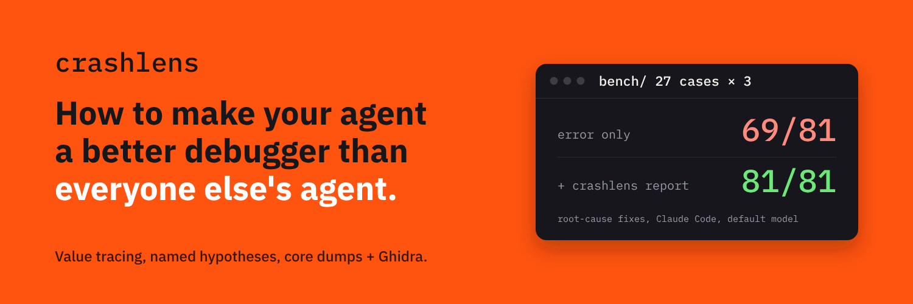
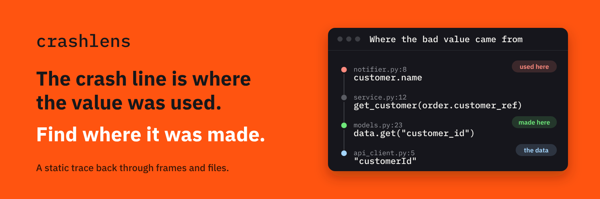
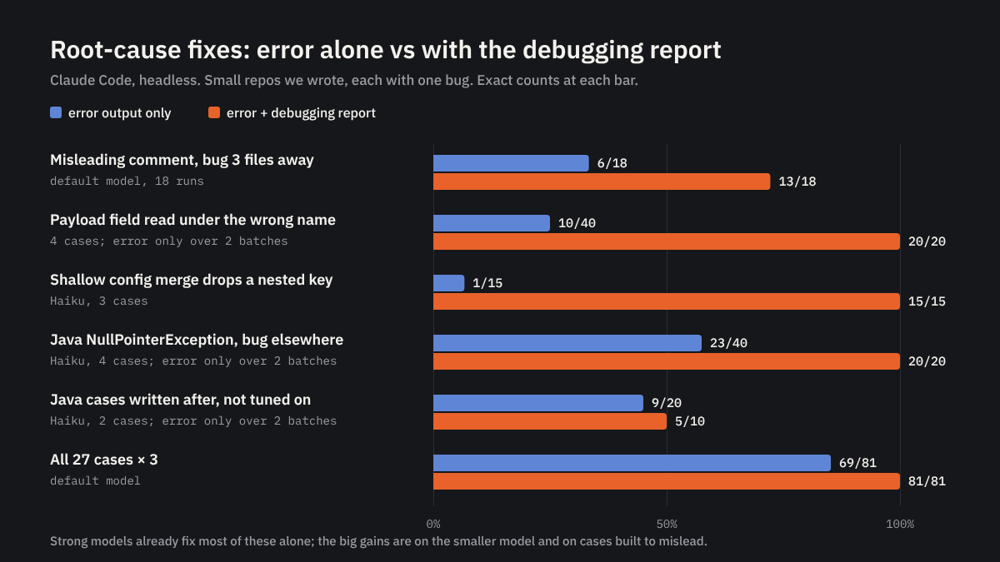

# How to make your agent a better debugger than everyone else's agent



Give a coding agent a crash and it will make the crash go away. That is not
the same as fixing the bug.

Here is one test case. An online store crashes while sending a receipt email,
because the customer is missing. Right next to the crash, a comment in the
code says customers "can be missing for guest checkouts".

Given only the error, Claude Code "fixed" it like this in **12 of 18 runs**:

```diff
+ if customer is None:
+     return   # skip the receipt
```

The crash is gone. So are all the receipts, forever.

The real bug was three files away. The store's API sends the customer as
`customerId`, and the code reads `customer_id`. One spelling difference, and
every order looks like a guest checkout.

The agent didn't do anything stupid. It read the code in front of it, trusted
the comment, and made the error stop. The problem is what it was looking at.

**The line that crashed is where a bad value was used. The bug is where that
value was made.** An error message only shows you the first place.

We built [crashlens](https://github.com/mingleiw/crashlens) to show agents the
second one. It reads the crash and your code, follows the bad value back to
where it came from, and says what probably went wrong there. It never runs
your program. For crashes in compiled programs, it's built on
[REA](https://github.com/morluto/rea) (Reverse Engineer Anything).

Here's what made agents better at debugging, what didn't, and the real
numbers.

## 1. Show the path, not more logs

When an agent gets it wrong, the instinct is to give it more: more logs, more
files, more context. That doesn't help when the most convincing thing in the
context is a wrong comment. More context just means more wrong comments.

What helped was a short trail: this value came from here, which came from
there, ending at the line where it was made.



With that trail added to the prompt, correct fixes went from **6 of 18 to 13
of 18**.

## 2. Name the suspect

13 of 18 is better, but the agent still had to spot the spelling difference
on its own. Sometimes it didn't.

So crashlens started checking the code against the project's own sample
data. When code reads a field that the data spells differently, it says so,
in plain words:

> customer_ref is read from data.get("customer_id"), but no data sample in the
> project has customer_id; it has customerId.

That made the biggest difference of anything we tried. On four cases like
this, the error alone led to the right fix in 5 of 20 runs. The report that
showed the trail but didn't name the field: 9 of 20. The report that named
it: **20 of 20**.

The lesson: **pointing at a line leaves room for the agent to guess. Naming
the suspect gives it something to check.**

## 3. Look where bugs like to hide

Some of the worst bugs hide in boring places. Settings files are a classic.

A common pattern: load default settings, then load production settings on top.
If the production file says "database: use this server" and forgets to repeat
the connection limits, a simple merge throws the limits away. The program
crashes later, in database code that looks perfectly fine.

crashlens now follows a value through those merges and says which file
dropped which setting.

On three cases like this, with a smaller, cheaper model (Haiku), the error
alone got the right fix in **1 of 15** runs. Our earlier report got 10 of 15.
The one that names the dropped setting got **15 of 15**.

## 4. Read what the error is already telling you

Error messages often say more than tools use. Modern Java, for example, says
exactly which variable was empty when it crashed. crashlens takes that and
follows the variable back to where it went wrong.

One test case: the code looks up a setting called `region.default`, but the
settings file calls it `default.region`. Without the hint, Haiku "fixed" it in
5 of 5 runs by adding a fallback for the missing value. With the hint, all 5
runs fixed the name.

Across four Java cases, Haiku got the right fix in **11 to 12 of 20** runs from
the error alone, 12 of 20 with our earlier report, and **20 of 20** with the
new one.

## 5. No source code? Read the crash itself

The hardest case: a compiled program crashes on a server, you only have the
crash dump, and the program was built without debugging info. To an agent,
that's a wall of hex numbers.

Here REA and Ghidra (the NSA's open-source decompiler) do the heavy lifting.
They turn the machine code around the crash back into readable code, so the
agent sees something like "this memory was freed, then used" instead of
addresses.

With that, the agent reached the root cause in **1 turn instead of 4**, at
about a third less cost. On 7 kinds of crashes with no source code available,
it found the right cause in 6 and narrowed down the 7th.

## 6. Stay quiet when you're not sure

A tool that's confidently wrong is worse than no tool, because agents believe
it. Every check in crashlens has rules for when to say nothing: when the data
comes from outside the project, when a value is filled in by a framework,
when the code is too unclear to follow.

When we added the Java checks, we made sure reports for every other test case
stayed exactly the same. And everything crashlens suggests is labeled as a
guess to verify, not a fact.

## The scoreboard

We test this with a set of small crashing projects. A coding agent (Claude
Code) gets either the error alone or the error plus the crashlens report, then
we check whether it fixed the real bug or just hid the crash.



Across all 27 test cases, three runs each, with Claude's default model:

- **Error alone: 69 of 81** runs fixed the real bug.
- **With crashlens: 81 of 81.**

Every one of the 12 misses was the same move from the top of this article:
hide the crash where it happened.

## What we're not claiming

**We wrote the test cases.** They're 27 small projects, most with a
misleading comment planted near the crash. This is a test suite for an idea,
not a scientific study.

**Strong models mostly don't need it.** Claude's default model fixed nearly
all the Java cases without crashlens (39 of 40 runs). There, the report mostly made it faster. The
big jumps are with smaller models and with cases designed to mislead.

**It didn't help on cases we didn't plan for.** After finishing the Java
support, we wrote two new Java cases with kinds of bugs crashlens doesn't
recognize. It made no difference: Haiku got 6 of 10 with the old report and
5 of 10 with the new one.

**Results vary run to run.** The same setup scored 1 of 5 one time and 4 of 5
the next. Five runs is enough to see 1 of 15 vs 15 of 15, not small gaps.

**Our scoring had bugs too.** Twice we found our automatic grading was wrong
and fixed it, then re-graded every affected run the same way. Read the actual
fixes before trusting anyone's numbers, ours included.

**Some things made no difference.** When the error already showed the values
of the variables, the agent found the bug without help. On simple one-file
bugs, the report just added reading.

## If you're building an agent

1. **Follow the bad value back.** Show where it was made, not just where it
   crashed.
2. **Name the suspect.** "Spelled X here, Y there" beats "look at this line".
3. **Check the code against the project's own data.** Sample files and
   settings files are ground truth that agents ignore unless you show them.
4. **Use what the error already says.** It's often more precise than you think.
5. **Stay quiet when unsure.** A wrong hint costs more than no hint.
6. **Test on cases built to mislead,** and count "hid the crash" as a failure.

crashlens is free and open source, works offline, and never runs your
program. Try it in Claude Code:

```text
/plugin install crashlens --marketplace mingleiw/crashlens
```

Or paste a stack trace into the [live demo](https://mingleiw.github.io/crashlens/).
If you have a crash that stumped your agent, open an issue. Real crashes make
better test cases than ours.
